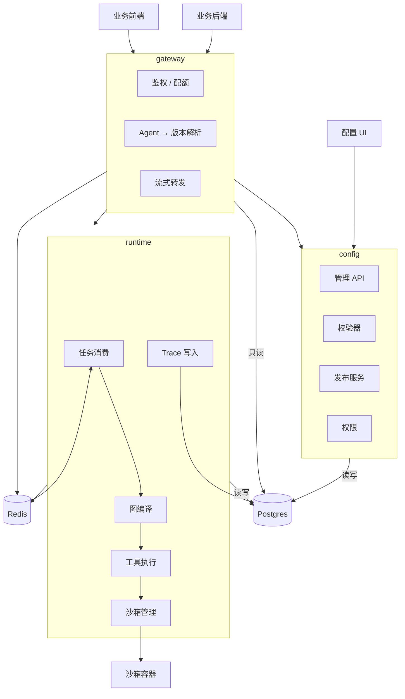

# Agent 平台设计文档（概要设计）

- 状态：草稿（待评审）
- 日期：2026-10-08
- 范围：v1 概要设计 —— 定位、架构、设计要点、工程结构、权衡。**细节全在专题文档里，本文档只给结论与指向。**
- 关联：
  - [02-sdk-contract.md](./02-sdk-contract.md) —— 对外调用契约
  - [03-domain-model.md](./03-domain-model.md) —— 领域划分与实现约定
  - [04-orchestration.md](./04-orchestration.md) —— 编排
  - [05-execution-and-streaming.md](./05-execution-and-streaming.md) —— 运行、事件与推流
  - [06-release.md](./06-release.md) —— 配置、版本与发布
  - [07-tools-and-skills.md](./07-tools-and-skills.md) —— 工具与 Skill
  - [08-credentials.md](./08-credentials.md) —— 凭据
  - [09-permissions.md](./09-permissions.md) —— 权限
  - [10-roadmap.md](./10-roadmap.md) —— 路线图与待定项

---

## 1. 概述

一个 Agent 平台。团队在上面**定义 Agent → 配置工具与 Skill → 编排流程 → 运行调试 → 发布**，然后**由外部系统通过 SDK 调用**。

一句话概括两种视角：

- **对配置者**：一个定义与发布 Agent 的地方，用 UI 操作。
- **对调用方**：一个服务，用 SDK 调 Agent，**看不见**工具、Skill、编排方式、版本这些内部概念。

Agent 的编排方式有两种，按流程的确定性选择：**流程确定时画图（DAG），流程不确定时用 ReAct**。二者在编译层统一，执行引擎只有一套。

### 1.1 v1 范围

| 能力 | v1 |
|---|---|
| Agent 定义与配置管理（UI + API） | ✅ |
| 两种编排：ReAct / DAG | ✅ |
| 工具：外部 HTTP API / Python 脚本（容器隔离） | ✅ |
| 凭据：Agent 专用的外部账号，租户登记、加密存储 | ✅ |
| Skill：指令知识包，渐进披露加载 | ✅ |
| 子 Agent（ReAct 暴露为工具 / DAG 作为节点） | ✅ |
| 对外调用：后端 Python SDK + 前端 TypeScript SDK | ✅ |
| 观测（运行日志、成本） | ✅ |
| 版本管理与发布（草稿 / 发布 / 回滚 / diff / 跨环境迁移） | ✅ |
| 多租户与团队内权限 | ✅ |

### 1.2 非目标（v1 明确不做）

**DAG 可视化拖拽画布**；**单点登录**；MCP 协议支持；分布式沙箱（多节点执行）；评测与数据集；插件市场；灰度发布；配置的 Git 管理。

> 画布缺席不影响 DAG 落地 —— v1 用表单与 JSON 编辑图结构（见 [10-roadmap.md](./10-roadmap.md) 待定项 1）。登录的见 [10-roadmap.md](./10-roadmap.md) 待定项 2。

---

## 2. 总体架构

三个服务。划分依据不是"技术分层"，而是**变更驱动**：对外契约跟着调用方需求变，配置模型跟着业务变，执行引擎跟着模型与运行时变。三者互不牵连。



### 2.1 三个服务

| 服务 | 职责 | 写领域表 |
|---|---|---|
| `gateway` | 对外协议、鉴权、配额、会话、流式转发 | ❌ 只读 |
| `config` | 定义、发布、版本、权限、查询、导入导出 | ✅ **配置与发布的唯一写者** |
| `runtime` | 图编译、LLM 调用、工具执行、沙箱、运行日志 | ✅ **执行记录的唯一写者** |

**每张表只有一个写者。** 这保证了并发与不变式有唯一入口 —— **唯一的例外是 `audit`**，它按设计就是多写者，只追加不修改。

### 2.2 关键约束

- **只有 `runtime` 调用 LLM。** `gateway` 与 `config` 不发起任何模型调用。
- **Postgres 是配置的唯一真相源。** 配置通过 UI/API 管理，不使用 Git 管理。
- **`runtime` 无状态。** 会话状态外置到数据库，Worker 崩溃后任务可重投。
- **权限校验在两处发生**：配置面判角色 + 调用面判 key。出队前还会重新校验一次 key —— **重置之后，已入队的任务不再执行**。
- **服务之间只通过接口通信**，不共享写路径。

### 2.3 部署形态

v1 单机 `docker-compose`：

| 服务 | 说明 |
|---|---|
| `gateway` | 对外接入，无状态，可多副本 |
| `config` | 配置与发布，无状态，可多副本 |
| `runtime` | 图编译与执行，可多副本，需挂载容器运行时 |
| `postgres` | 唯一数据存储 |
| `redis` | 任务队列 + 流式事件分发 |
| `web` | 配置 UI 静态资源 |
| `nginx` | 反向代理（对外只暴露 `gateway` 与 `web`） |

沙箱不单独部署服务，由 `runtime` 内嵌的沙箱管理器直接管理。

**一套 `docker-compose` 就是一个环境。** 开发、预生产、生产各部署一套，各有一套数据库、调用 key 与凭据；配置靠导入导出在环境之间搬（见 [06-release.md](./06-release.md) 第 3 节）。**平台内部没有环境这一层。**

---

## 3. 设计要点

每一条只给结论，细节在各自的专题文档里。

### 3.1 对外契约

**SDK 是平台对外的唯一入口，入参只认三样东西：key、输入、会话。** 工具定义、Skill 正文、凭据、编排方式、版本、图的形状都不出现在契约里 —— **任何内部结构泄漏到 SDK，都会立刻变成无法修改的兼容性负担。**

**事件里会出现租户自己的引用** —— 工具名、分支标签、子 Agent 名，它们描述这次运行做了什么。边界是**引用外发，内容不外发**：System Prompt 与 Skill 正文属于配置，不出现。

**key 决定调谁**：后端拿 Agent 的永久 key，前端拿换来的临时 key，都在构造 client 时给。后端是 Python 包，前端是 TypeScript 纯脚本库（不提供 UI、不绑定框架），两者方法一一对应。

调用模型是 **submit 返回句柄**：「怎么等」由句柄上的方法决定，于是对话式与任务式不是两套 API，而是同一套的两个用法 —— **调用方式由调用方选，不由编排方式决定**，否则 ReAct 迁到 DAG 会变成对外破坏性变更。

> 详见 [02-sdk-contract.md](./02-sdk-contract.md)。

### 3.2 领域模型

模型按**领域**组织，划分依据是**变更原因与所有权** —— 同一个领域里的表，因为同样的理由被改动、被同一批人关心。八个领域，依赖方向**必须无环**：

```
       ┌──→ tool ────┐
       │             │
iam ───┼──→ skill ───┼──→ agent ──→ release ──→ execution
       │             │
       └──→ secrets ─┘

audit ← 被所有领域写入（不反向依赖任何领域）
```

**运行只认已发布的版本**：会话与 Run 都绑定版本快照，定义可以改，历史执行仍能精确复现。执行域因此只依赖 `release`；**唯一的例外是凭据** —— 它不进快照，运行时读活的那一份。

> 详见 [03-domain-model.md](./03-domain-model.md)：八个领域各装什么、边界的关键判断、依赖方向规则、实现约定、未来领域的接入点。

### 3.3 编排与运行

两种模式按**下一步能不能事先枚举**来选：能 → `dag`，不能 → `react`。

**两种模式编译成同一张图，执行引擎只有一套。** 运行日志模型、状态机、重投机制、沙箱调用因此全部共用，差别被压缩到编译这一层 —— 这让"流程稳定后从 ReAct 迁到 DAG"成为一条演进路径，而不是一次重写。

`runtime` 的入口是**编译**，不是解释：取已发布版本的快照 → 编译成执行图 → 运行 → 每步落日志。`gateway` 只传"哪个 Agent 的哪个版本 + 输入 + 会话 + 调用方"，**它不知道也不传编排结构** —— 这是两个服务能各自演进的原因。

**运行日志是唯一真相源。** 一行一个事实，只追加 —— Run 的状态、对外的事件流、断线重连、崩溃续跑都是它的不同读法。**事件是它的视图**：类型一一对应，内容有取舍 —— 租户自己的引用与这次运行的数据外发，配置的内容不外发。

> 编排怎么选、ReAct 的价值与代价、DAG 的节点与校验不变式、子 Agent 与嵌套，见 [04-orchestration.md](./04-orchestration.md)。
> 运行怎么记录、怎么推、断线怎么续、崩溃怎么重投，见 [05-execution-and-streaming.md](./05-execution-and-streaming.md)。

### 3.4 配置与发布

**编辑在领域实体上（草稿态），发布是快照。** 编辑的并发用实体上的锁版本，发布的并发用发布记录上的状态 —— 两件事，不混在一起。

**快照只含配置** —— 编排、挂载，以及挂载到的 Tool / Skill 的版本号。不含调用 key、责任人、归档标志。

> 详见 [06-release.md](./06-release.md)。

### 3.5 工具与 Skill

工具是**能执行的东西**（外部 HTTP 接口，或容器隔离的 Python 脚本）；Skill 是**要读的知识**（渐进披露：只注入名称与描述，正文按需拉取）。两者是并列的独立领域，唯一的共同点是被 Agent 引用 —— 而那是关系，不是本质。**两者都按租户隔离。**

**凭据不写在工具里。** 工具只声明需要一份凭据，用哪一份由 Agent 决定 —— **Agent 是外部系统里的一个员工**，在那边有自己的账号。这样 SDK 契约才守得住：调用方既不需要知道凭据的存在，也不需要提供它。

> 详见 [07-tools-and-skills.md](./07-tools-and-skills.md) 与 [08-credentials.md](./08-credentials.md)。

### 3.6 权限

**权限完全由程序实现**，判定发生在应用层，不使用数据库的 `GRANT` / `REVOKE`。

**配置面**只有团队成员，三种角色：管理员 / 编辑 / 只读。没有独立的运行角色 —— 跑 Agent 的是外部程序，不是团队成员。**责任人只是元数据**，标明谁创建维护，不含权限含义。

**调用面**只有 key：一个 Agent 一把永久 key 给后端，前端用拿永久 key 换来的、有效期 1 小时的临时 key。**持有 key 就是授权** —— 没有独立的授权表，也没有"应用"这一层实体。调用时带上来的**终端用户标识只作审计，不参与判权**。

**平台不判运行与会话的归属。** 会话是单主体的 —— 前端提交的归那个终端用户，后端提交的归调用方自己 —— 但主体只标归属，不判权，也不限定能读哪些 Run。换临时 key 的是调用方自己的后端，主体是它声明的一句话。**读的隔离因此落在调用方身上。**

**v1 只有资源级权限，没有工具级权限** —— 升级触发条件是第一个外部调用方调用会写外部系统的 Agent。

> 详见 [09-permissions.md](./09-permissions.md)。

---

## 4. 工程结构

```
agent-ops/
├── docs/              # 设计文档
├── contract/          # 对外协议定义（唯一真相源，gateway 与 SDK 共用）
├── shared/            # 共享 spec 模型（领域模型的唯一定义）
├── config/            # 配置服务
├── gateway/           # 接入服务
├── runtime/           # 执行服务
├── sandbox/           # 沙箱基础镜像与执行器
├── sdk/
│   ├── python/        # 后端 SDK
│   └── typescript/    # 前端 SDK
├── web/               # 配置 UI
└── deploy/            # docker-compose 与部署脚本
```

`contract/` 与 `shared/` 是 DRY 的两个支点：

- `contract/` 保证**对外协议只有一份定义** —— 接入服务的路由与两个 SDK 的方法签名都由它来。
- `shared/` 保证**快照序列化只有一份实现** —— 配置侧的校验、执行侧的编译、导入导出、版本回滚全部依赖它。

---

## 5. 关键权衡与风险

| # | 取舍 | 收益 | 代价 |
|---|---|---|---|
| 1 | 按领域建模 | 边界清晰；独立的版本与审计领域；依赖方向可验证 | 跨领域查询变啰嗦，需要读模型 |
| 2 | 不使用共享父表 | 领域模型不被技术诉求污染 | 失去"统一资源列表"，必须建读模型并维护投影 |
| 3 | **不使用数据库外键** | 写入路径无外键锁开销；便于将来拆库 | 完整性降级为程序强制；需自制五道防线 |
| 4 | **权限全部程序实现** | 授权模型可以任意复杂；不受数据库角色体系限制 | 无数据库层兜底，任何绕过服务层的写入都不受限 |
| 5 | 领域边界用前缀而非数据库 schema | 迁移、备份简单；跨领域查询无 schema 前缀负担 | 边界在数据库层不可见 |
| 6 | **凭据用 Agent 专用账号，由租户登记** | SDK 契约干净、多租户天然隔离、前端可用、重投可用 | 多一个领域；外部系统那边要为每个 Agent 开账号，且分不清"谁在操作" |
| 7 | **同时支持 ReAct 与 DAG** | 灵活与可控并存；**给演进留了明确路径** | 两套校验不变式；编译层要做两遍映射 |
| 8 | **拆成三个服务** | 对外契约、配置模型、执行引擎各自演进，互不牵连 | 三次部署与发版；多一跳；跨服务排障更麻烦 |
| 9 | **领域按变更驱动细分（八个领域）** | 边界与所有者对齐，每个域装什么没有歧义 | 跨领域引用增多；领域变小变多，单看每一个收益不明显 |
| 10 | **SDK 屏蔽全部内部概念** | 内部怎么改都不破坏兼容性 | 调用方无法针对特定编排做优化；排障要靠平台侧提供信息 |
| 11 | 配置由 UI 与数据库管理（而非 Git） | 编辑路径直接、无 merge 冲突 | 失去 PR review 与 Git 历史；审计日志成为唯一追溯手段 |
| 12 | Python 工具预构建镜像，容器用完即弃 | 安全、快、无状态污染 | 加工具要走一次镜像构建；每次调用有冷启动开销 |
| 13 | **key 即授权（没有独立授权表）** | 少一层实体、少一张表；判定一步完成 | 一个 Agent 一把 key，所有后端调用方共用，出了事分不清是谁；**平台不判运行与会话的归属 —— 读的隔离由调用方承担** |

> 实施顺序与尚未决定的问题见 [10-roadmap.md](./10-roadmap.md)。
