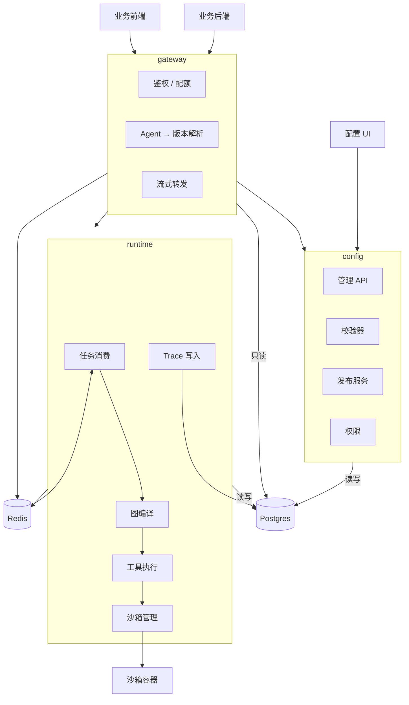

# Agent 平台设计文档（概要设计）

- 状态：草稿（待评审）
- 日期：2026-10-08
- 范围：v1 概要设计 —— 架构、领域划分、核心模型、权限与部署。**表结构与实现细节不在本文档范围内。**
- 详细设计存档：commit `58e184d`（`git show 58e184d:docs/data-model.md`）
- 关联：
  - [domain-model.md](./domain-model.md) —— 领域划分与实现约定
  - [sdk-contract.md](./sdk-contract.md) —— 对外调用契约
  - [orchestration.md](./orchestration.md) —— 编排与执行
  - [roadmap.md](./roadmap.md) —— 路线图与待定项

---

## 1. 概述

一个 Agent 平台。团队在上面**定义 Agent → 配置工具与 Skill → 编排流程 → 运行调试 → 发布**，然后**由外部系统通过 SDK 调用**。

一句话概括两种视角：

- **对配置者**：一个定义与发布 Agent 的地方，用 UI 操作。
- **对调用方**：一个服务，用 SDK 调 Agent，**看不见**工具、Skill、编排方式、版本这些内部概念。

Agent 的编排方式有两种，按流程的确定性选择：**流程确定时画图（DAG），流程不确定时用 ReAct**。二者在编译层统一，执行引擎只有一套。

### 1.1 v1 范围

| 能力 | v1 |
|---|---|
| Agent 定义与配置管理（UI + API） | ✅ |
| 两种编排：ReAct / DAG | ✅ |
| 工具：外部 HTTP API / Python 脚本（容器隔离） | ✅ |
| Skill：指令知识包，渐进披露加载 | ✅ |
| 子 Agent（ReAct 暴露为工具 / DAG 作为节点） | ✅ |
| 对外调用：后端 Python SDK + 前端 TypeScript SDK | ✅ |
| 观测与调试（trace、Playground、成本） | ✅ |
| 版本管理与发布（草稿 / 发布 / 回滚 / diff） | ✅ |
| 多租户与团队内权限 | ✅ |

### 1.2 非目标（v1 明确不做）

**DAG 可视化拖拽画布**；**凭据管理领域**；**单点登录**；MCP 协议支持；分布式沙箱（多节点执行）；评测与数据集；插件市场；灰度发布；配置的 Git 管理。

> 画布缺席不影响 DAG 落地：v1 用表单与 JSON 编辑图结构，画布随后补。凭证的加回位置见 [domain-model.md](./domain-model.md) 第 5 节；登录的见 [roadmap.md](./roadmap.md) 待定项 2。

---

## 2. 总体架构

三个服务。划分依据不是"技术分层"，而是**变更驱动**：对外契约跟着调用方需求变，配置模型跟着业务变，执行引擎跟着模型与运行时变。三者互不牵连。



### 2.1 三个服务

| 服务 | 职责 | 写领域表 |
|---|---|---|
| `gateway` | 对外协议、鉴权、配额、会话、流式转发 | ❌ 只读 |
| `config` | 定义、发布、版本、权限、查询、导入导出 | ✅ **配置与发布的唯一写者** |
| `runtime` | 图编译、LLM 调用、工具执行、沙箱、trace | ✅ **执行记录的唯一写者** |

**关键不是"谁碰数据库"，而是"每张表只有一个写者"。** 这条比"网关零依赖"更实在 —— 它保证了并发与不变式有唯一入口。

### 2.2 关键约束

- **只有 `runtime` 调用 LLM。** `gateway` 与 `config` 不发起任何模型调用。
- **Postgres 是配置的唯一真相源。** 配置通过 UI/API 管理，不使用 Git 管理。
- **`runtime` 无状态。** 会话状态外置到数据库，Worker 崩溃后任务可重投。
- **权限校验在两处发生**：配置面（编辑/查询）+ 执行面出队前（运行）。后者不可省略。
- **服务之间只通过接口通信**，不共享写路径。

---

## 3. SDK 契约

**SDK 是平台对外的唯一入口，只认三样东西：Agent 名、输入、会话。** 工具、Skill、编排方式、版本、节点这些内部概念全部不出现在契约里 —— **任何内部概念泄漏到 SDK，都会立刻变成无法修改的兼容性负担。**

| SDK | 语言与形态 | 身份 |
|---|---|---|
| 后端 | **Python 包**，同步 + 异步两套 | 应用凭据（API Key） |
| 前端 | **TypeScript 包**，纯脚本库 | 调用方后端签发的用户令牌 |

**前端 SDK 不提供 UI，不绑定任何框架**，浏览器与 Node 都能跑。两个 SDK 的方法、参数、事件类型**一一对应** —— 契约只定义一次，两种语言各实现一遍。

调用模型是 **submit 返回句柄**：`submit` 只负责发起，"怎么等"由句柄上的方法决定（阻塞 / 流式 / 稍后取）。于是对话式与任务式不是两套 API，而是同一套的两个用法 —— **调用方式由调用方选，不由 Agent 的编排方式决定**，否则 ReAct 迁到 DAG 会变成对外破坏性变更。

契约要点：幂等（请求标识）、会话可选、**超时不等于取消**（运行继续，要停必须显式取消）、**断线可续传**（事件带序号，从断点续推；保证不丢失、可能重复）。

> 详细契约见 [sdk-contract.md](./sdk-contract.md)。

---

## 4. 领域模型

模型按**领域**组织，不按技术分层 —— 划分依据是**变更原因与所有权**：同一个领域里的表，因为同样的理由被改动、被同一批人关心。

七个领域，依赖方向**必须无环**：

```
      ┌──→ tool ────┐
iam ──┤             ├──→ agent ──→ release ──→ execution
      └──→ skill ───┘

audit ← 被所有领域写入（不反向依赖任何领域）
```

| 领域 | 聚合根 | 装什么 |
|---|---|---|
| `iam` | Tenant | 租户（= 外部团队）、账号、成员、邀请、应用、凭据、配额、用量 |
| `tool` | Tool | 工具定义 |
| `skill` | Skill | Skill 定义 |
| `agent` | Agent | 定义、编排、挂载、子 Agent、对外授权 |
| `release` | Artifact | 草稿 → 版本 → 发布 → 回滚 |
| `execution` | Run | 会话、运行、trace |
| `audit` | AuditEntry | 变更审计，只追加 |

**运行只认已发布的版本**：会话与 Run 都绑定版本快照 —— 定义可以改，历史执行仍能精确复现。执行域因此只依赖 `release`，不碰 `agent` / `tool` / `skill`。

> 详见 [domain-model.md](./domain-model.md)：划分依据、边界的关键判断、依赖方向规则、实现约定、未来领域的接入点。

---

## 5. 编排与执行

Agent 的编排方式有两种：**流程确定时画图（`dag`），流程不确定时用 ReAct（`react`）**。判据只有一条 —— 这段流程的下一步能不能事先枚举。

**两种模式编译成同一张图，执行引擎只有一套。** trace 模型、状态机、重投机制、沙箱调用因此全部共用，差别被压缩到编译这一层。这让"流程稳定后从 ReAct 迁到 DAG"成为一条明确的演进路径，而不是一次重写。

`runtime` 的入口是**编译**，不是解释：取已发布版本的快照 → 编译成执行图 → 运行 → 每步落 trace。`gateway` 传来的只有"哪个 Agent 的哪个版本 + 输入 + 会话 + 调用方"，**它不知道也不传编排结构** —— 这是两个服务能各自演进的原因。

> 详见 [orchestration.md](./orchestration.md)：怎么选、ReAct 的价值与代价、DAG 的节点与校验不变式、子 Agent 与嵌套、运行与观测。

---

## 6. 配置与发布

### 6.1 编辑与发布

编辑发生在**领域实体**上（草稿态），不在发布域。每个实体带乐观锁版本号，并发修改冲突时返回冲突并展示字段级差异，供人工合并。

发布是**快照**：把领域实体序列化为不可变快照，版本号单调递增，写入发布域。归档只是标记，不物理删除。

**编辑的并发与发布的并发是两件事**，分别由实体上的锁版本与发布记录上的状态承担，不混在一起。

**会话与 Run 都绑定已发布的版本**，历史执行因此可精确复现。

### 6.2 版本与调试版本

"运行只认已发布版本"这条约束不能为了调试而打破，所以用**发布通道**把两条路径分开：

| 通道 | 谁产生 | 是否推进线上版本 |
|---|---|---|
| `stable` | 正式发布 | ✅ |
| `debug` | Playground 试跑 | ❌ |

调试版本**正常记录、可回放、进 trace**，只是不影响线上。这样既不用给执行域开一条旁路，也不用把试跑混进正式版本序列。

### 6.3 版本对比与导入导出

两个快照之间做结构化 JSON diff —— 结构由 schema 确定，因此可以渲染成字段级对比而非文本对比。

导入导出作为**通道**存在，不是真相源：备份、跨环境迁移、CI 校验。跨环境时 ID 必然不同，因此**引用在边界翻译成业务标识**，导入时再解析回本地 ID。导出的文件里绝不能出现明文密钥。

---

## 7. 工具与 Skill

### 7.1 工具形态

| 类型 | 执行方式 | 关键约束 |
|---|---|---|
| HTTP 工具 | `runtime` 直接发起请求 | 参数模板、占位符解析、超时与有限重试、**响应裁剪**（防止大响应撑爆上下文） |
| Python 工具 | 一次性容器 | 镜像**预构建**；网络默认**完全禁用**；只读根 + 可写输出目录；CPU/内存/磁盘/墙钟限额；stdin/stdout 走 JSON |

> **运行时不做依赖安装。** 加工具需要走一次镜像构建流程。这是刻意选择：运行时装依赖既是安全漏洞也是性能灾难。

### 7.2 凭据处理（v1 的临时方案）

v1 **没有凭据管理领域**。工具的认证信息在配置里写**占位符**，执行时由 `runtime` 从自己的环境变量解析。落库的只是占位符字符串，明文密钥永不落库、永不进导出文件。

**代价必须记在账上：**

| 缺失的能力 | 后果 |
|---|---|
| 集中管理 | 密钥分散在各 runtime 节点的部署环境，改一个要动所有节点 |
| 轮换机制 | 没有到期提醒，没有平滑轮换 |
| 使用审计 | 无法回答"哪个 Agent 用了这个密钥" |
| 租户隔离 | 环境变量是进程级的，多租户共用 runtime 时无法隔离 |

**在单个 runtime 承载多租户之前，凭据领域必须加回来。**

### 7.3 Skill 渐进加载

类渐进披露机制：Skill 的**名称与描述**总是注入系统提示（开销很小），全文只在需要时由模型通过内置工具拉取，拉取后进入会话上下文并可缓存。

因此绑定几十个 Skill 也不会撑爆上下文。**描述字段是必填的** —— 渐进披露完全依赖它来判断该不该拉取正文，缺了它这个机制就失效。

---

## 8. 权限

**权限完全由程序实现**，判定发生在应用层。

### 8.1 一个团队，两类主体

**租户就是外部团队。** 团队内的判权分两条路径：

| | 团队成员 | 团队的应用 |
|---|---|---|
| 干什么 | 配置、发布、调试 | 调用 Agent |
| 怎么证明 | 平台账号 | 应用凭据 / 用户令牌 |
| 判定依据 | 成员角色 + Agent 负责人 | 显式的"应用 → Agent"授权 |

**两条路径不通用** —— 应用的凭据换不来配置权，成员的身份也不是调用凭证。

**终端用户仍然不打通。** 调用时传进来的用户标识原样记录，**不当团队成员**，不参与团队内的角色判定 —— 平台不做单点登录，也不信任外部用户目录。

### 8.2 判定

**配置面**，顺序命中即停：

| 序 | 主体 | 依据 |
|---|---|---|
| ① | Agent 负责人 | 对该 Agent 全权（编辑 / 发布 / 运行 / 转移归属） |
| ② | 同租户成员 | 按角色：可编辑 / 可运行 / 只读 |
| ③ | 其他 | 拒绝 |

**只有 `agent` 有负责人。** `tool` 与 `skill` 是共享能力，没有归属人 —— 不存在"谁的 Tool"这种说法。

**调用面**：凭据有效 → 有显式授权 → 未超配额 → 放行。

**默认拒绝** —— 没有显式授权就调不动，"同租户"不构成授权理由。**授权由 Agent 负责人管理**，因为负责人天然有权决定自己的 Agent 对谁开放。

**对外只暴露 Agent。** Tool 和 Skill 不可直接调用，只能被 Agent 引用 —— 这砍掉了一大类越权面。

### 8.3 已知缺口：工具级权限

**v1 只有资源级权限，没有工具级权限。** Agent 能做什么，调用它的应用就间接能做什么 —— Agent 拿自己的权限替调用方做事，而调用方不一定有同样的权限（confused deputy）。

自用场景下可接受：维护者本来就是全权限。**升级触发条件是「第一个外部应用调用一个会写外部系统的 Agent」**，届时需要三件事：工具声明所需权限范围、只有具备该范围的调用方才能把它绑进 Agent、调用时校验发起者是否具备该范围。高风险工具还需人工审批。

---

## 9. 部署形态

v1 单机 `docker-compose`：

| 服务 | 说明 |
|---|---|
| `gateway` | 对外接入，无状态，可多副本 |
| `config` | 配置与发布，无状态，可多副本 |
| `runtime` | 图编译与执行，可多副本，需挂载容器运行时 |
| `postgres` | 唯一数据存储 |
| `redis` | 任务队列 + 流式事件分发 |
| `web` | 配置 UI 静态资源 |
| `nginx` | 反向代理（对外只暴露 `gateway` 与 `web`） |

沙箱不单独部署服务，由 `runtime` 内嵌的沙箱管理器直接管理。

---

## 10. 目录结构

```
agent-ops/
├── docs/              # 设计文档
├── contract/          # 对外协议定义（唯一真相源，gateway 与 SDK 共用）
├── shared/            # 共享 spec 模型（领域模型的唯一定义）
├── config/            # 配置服务
├── gateway/           # 接入服务
├── runtime/           # 执行服务
├── sandbox/           # 沙箱基础镜像与执行器
├── sdk/
│   ├── python/        # 后端 SDK
│   └── typescript/    # 前端 SDK
├── web/               # 配置 UI
└── deploy/            # docker-compose 与部署脚本
```

`contract/` 与 `shared/` 是 DRY 的两个支点：

- `contract/` 保证**对外协议只有一份定义** —— 接入服务的路由与两个 SDK 的方法签名都由它来。
- `shared/` 保证**快照序列化只有一份实现** —— 配置侧的校验、执行侧的编译、导入导出、版本回滚全部依赖它。

---

## 11. 关键权衡与风险

| # | 取舍 | 收益 | 代价 |
|---|---|---|---|
| 1 | 按领域建模 | 边界清晰；独立的版本与审计领域；依赖方向可验证 | 跨领域查询变啰嗦，需要读模型 |
| 2 | 不使用共享父表 | 领域模型不被技术诉求污染 | 失去"统一资源列表"，必须建读模型并维护投影 |
| 3 | **不使用数据库外键** | 写入路径无外键锁开销；便于将来拆库 | 完整性降级为程序强制；需自制五道防线 |
| 4 | **权限全部程序实现** | 授权模型可以任意复杂；不受数据库角色体系限制 | 无数据库层兜底，任何绕过服务层的写入都不受限 |
| 5 | 领域边界用前缀而非数据库 schema | 迁移、备份简单；跨领域查询无 schema 前缀负担 | 边界在数据库层不可见 |
| 6 | **v1 不做凭据管理** | 少一个领域，快速落地 | **密钥分散、无法轮换、无使用审计、无租户隔离** |
| 7 | **同时支持 ReAct 与 DAG** | 灵活与可控并存；**给演进留了明确路径** | 两套校验不变式；编译层要做两遍映射 |
| 8 | **拆成三个服务** | 对外契约、配置模型、执行引擎各自演进，互不牵连 | 三次部署与发版；多一跳；跨服务排障更麻烦 |
| 9 | **领域按变更驱动细分（7 个域）** | 边界与所有者对齐，每个域装什么没有歧义 | 跨领域引用增至 6 条；领域变小变多，单看每一个收益不明显 |
| 10 | **SDK 屏蔽全部内部概念** | 内部怎么改都不破坏兼容性 | 调用方无法针对特定编排做优化；排障要靠平台侧提供信息 |
| 11 | 配置由 UI 与数据库管理（而非 Git） | 编辑路径直接、无 merge 冲突 | 失去 PR review 与 Git 历史；审计日志成为唯一追溯手段 |
| 12 | Python 工具预构建镜像，容器用完即弃 | 安全、快、无状态污染 | 加工具要走一次镜像构建；每次调用有冷启动开销 |

> 实施顺序与尚未决定的问题见 [roadmap.md](./roadmap.md)。
