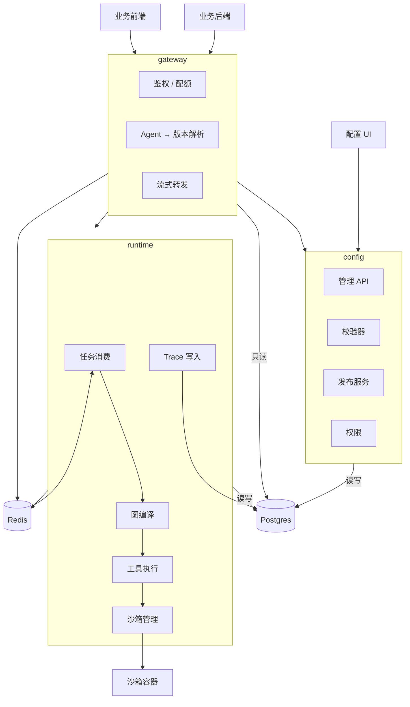

# Agent 平台设计文档（概要设计）

- 状态：草稿（待评审）
- 日期：2026-10-08
- 范围：v1 概要设计 —— 架构、领域划分、核心模型、权限与部署。**表结构与实现细节不在本文档范围内。**
- 详细设计存档：commit `58e184d`（`git show 58e184d:docs/data-model.md`）

---

## 1. 概述

一个 Agent 平台。团队在上面**定义 Agent → 配置工具与 Skill → 编排流程 → 运行调试 → 发布**，然后**由外部系统通过 SDK 调用**。

一句话概括两种视角：

- **对配置者**：一个定义与发布 Agent 的地方，用 UI 操作。
- **对调用方**：一个服务，用 SDK 调 Agent，**看不见**工具、Skill、编排方式、版本这些内部概念。

Agent 的编排方式有两种，按流程的确定性选择：**流程确定时画图（DAG），流程不确定时用 ReAct**。二者在编译层统一，执行引擎只有一套。

### 1.1 v1 范围

| 能力 | v1 |
|---|---|
| Agent 定义与配置管理（UI + API） | ✅ |
| 两种编排：ReAct / DAG | ✅ |
| 工具：外部 HTTP API / Python 脚本（容器隔离） | ✅ |
| Skill：指令知识包，渐进披露加载 | ✅ |
| 子 Agent（ReAct 暴露为工具 / DAG 作为节点） | ✅ |
| 对外调用：后端 Python SDK + 前端 TypeScript SDK | ✅ |
| 观测与调试（trace、Playground、成本） | ✅ |
| 版本管理与发布（草稿 / 发布 / 回滚 / diff） | ✅ |
| 多租户与两套权限 | ✅ |

### 1.2 非目标（v1 明确不做）

**DAG 可视化拖拽画布**；**凭据管理领域**；**单点登录**；MCP 协议支持；分布式沙箱（多节点执行）；评测与数据集；插件市场；灰度发布；配置的 Git 管理。

> 画布缺席不影响 DAG 落地：v1 用表单与 JSON 编辑图结构，画布随后补。凭证与登录的加回位置见 4.3 与 7.2。

---

## 2. 总体架构

三个服务。划分依据不是"技术分层"，而是**变更驱动**：对外契约跟着调用方需求变，配置模型跟着业务变，执行引擎跟着模型与运行时变。三者互不牵连。



### 2.1 三个服务

| 服务 | 职责 | 写领域表 |
|---|---|---|
| `gateway` | 对外协议、鉴权、配额、会话、流式转发 | ❌ 只读 |
| `config` | 定义、发布、版本、权限、查询、导入导出 | ✅ **配置与发布的唯一写者** |
| `runtime` | 图编译、LLM 调用、工具执行、沙箱、trace | ✅ **执行记录的唯一写者** |

**关键不是"谁碰数据库"，而是"每张表只有一个写者"。** 这条比"网关零依赖"更实在 —— 它保证了并发与不变式有唯一入口。

### 2.2 关键约束

- **只有 `runtime` 调用 LLM。** `gateway` 与 `config` 不发起任何模型调用。
- **Postgres 是配置的唯一真相源。** 配置通过 UI/API 管理，不使用 Git 管理。
- **`runtime` 无状态。** 会话状态外置到数据库，Worker 崩溃后任务可重投。
- **权限校验在两处发生**：配置面（编辑/查询）+ 执行面出队前（运行）。后者不可省略。
- **服务之间只通过接口通信**，不共享写路径。

---

## 3. SDK 契约

### 3.1 两个 SDK，一套契约

| SDK | 语言与形态 | 身份 |
|---|---|---|
| 后端 | **Python 包**，同步 + 异步两套 | 应用凭据（API Key） |
| 前端 | **TypeScript 包**，纯脚本库 | 调用方后端签发的用户令牌 |

**前端 SDK 不提供 UI，不绑定任何框架。** 它只做四件事：发请求、订阅流、管会话、转发令牌。浏览器与 Node 都能跑。

**两个 SDK 的方法、参数、事件类型一一对应** —— 契约只定义一次，两种语言各实现一遍。能力面一致：调用（同步/流式）、查状态、取消、开会话。前端 SDK 的令牌由一个回调提供，指向调用方自己的后端 —— **SDK 内不留存任何长期凭据**。

### 3.2 契约要点

- **幂等** —— 调用方带请求标识，网络重试不会重复执行。
- **会话可选** —— 不传会话就是单次调用；传了则续上多轮上下文。
- **可取消** —— 长任务可以中断，已产生的 token 成本照记。
- **流式事件只描述进度**，不带节点、工具、模型等内部标识。

### 3.3 屏蔽细节

**SDK 只认三样东西：Agent 名、输入、会话。** 以下概念一律不出现在对外契约里：

| 不暴露 | 原因 |
|---|---|
| 编排方式是 ReAct 还是 DAG | 内部实现，改了不影响调用方 |
| 节点、边、工具名、Skill 名 | 配置细节，调用方不需要也不该依赖 |
| 版本号 | 平台决定用哪个版本；需要钉版本的场景走内部调试通道 |
| 模型与参数 | 同上 |

这条是硬约束：**任何内部概念泄漏到 SDK，都会立刻变成无法修改的兼容性负担。**

---

## 4. 领域模型

### 4.1 划分依据

模型按**领域**组织，不按技术分层。划分依据是**变更原因与所有权**：同一个领域里的表，因为同样的理由被改动、被同一批人关心。

依赖方向**必须无环**：

```
iam ──→ definition ──→ release ──→ execution

audit ← 被上述所有领域写入（不反向依赖任何领域）
```

| 领域 | 聚合根 | 职责 | 变更驱动 |
|---|---|---|---|
| `iam` | Tenant | 租户、成员、调用方应用 | 组织与接入调整 |
| `audit` | AuditEntry | 变更审计，只追加 | 合规要求 |
| `definition` | Agent / Tool / Skill | 定义：Agent 蓝图与编排、工具接入、Skill 知识包、对外开放声明 | 定义本身的演进 |
| `release` | Artifact | 草稿 → 版本 → 发布 → 回滚 | 发布策略 |
| `execution` | Run | 会话、运行、步骤、trace | 引擎演进与性能 |

**命名原则：前缀描述事物，不描述活动。** 用 `definition` / `release` 这样的名词，不用动名词 —— 前者一眼知道表里装什么，后者只说明这里在干什么。

**领域边界的依据：**

- **`release` 独立于各资源类型。** 版本与发布有自己的语言（草稿/发布/回滚/changelog）和不变式（版本单调、发布不可变），而且它**泛化于所有可发布物** —— 今天有 Agent/Tool/Skill，明天可能有 Prompt/Dataset/Eval。由它持有版本表，各领域不各自造一套。
- **`audit` 独立于 `iam`。** 两者的变更驱动不同（合规 vs 组织调整），且审计被**所有**领域写入。塞进一个笼统的"治理"领域，只会让边界说不清。
- **Tool / Skill / Agent 同属 `definition`。** 三者是同一类事物：**声明式的、可版本化的、定义一次可复用多次的蓝图**。它们放同一个领域 —— 变更驱动一致（都是"改定义"），而且 Agent 引用 Tool/Skill 这条关系因此留在领域内，不必跨域。
- **运行实例不在定义域，也不直接引用定义。** 一份定义可以开出多个会话、多次运行 —— 但那属于 `execution`，而且执行域**只引用发布版本，不引用定义本身**。**运行只认已发布的版本。** 这比单纯的"定义 / 实例"分家更严 —— 它让依赖图严格线性，也让每一次运行都能精确复现。
- **每个领域的实体自己持有身份与并发控制。** 没有共享父表；定义域里只有 Agent 有负责人。跨领域的统一列表走读模型。

### 4.2 设计原则

1. **领域边界用表名前缀表达，不用数据库 schema。** 领域边界是应用层概念，不是数据库对象边界。单 schema 让迁移、备份、跨领域查询都保持简单。
2. **活数据强类型，历史快照序列化。** 当前态用真列与约束；发布快照用 JSONB —— 快照不可变、不按字段查询，JSONB 反而让版本 diff 退化为 JSON 比较。
3. **不使用数据库外键，引用完整性由应用层在事务内保证。** 代价是完整性从数据库强制降为程序强制，且失去级联删除与类型安全引用。**必须在应用层补齐引用清单、写入前校验、删除规则、孤儿巡检、导入路径五道防线** —— 那是强制要求，不是建议。
4. **权限全部由程序实现。** 数据库只有一个应用账号，对所有表有完整权限，判定发生在应用层。
5. **除执行域与审计域外一律软删除。** 实体删除 = 归档，行保留。这同时消除了大部分悬空引用风险。
6. **跨领域引用只能多态表达。** 用 `(种类, id)` 而非具体外键列 —— 领域之间本来就不该有强耦合的引用。
7. **授权关系跟着被保护的资源走，不跟着主体走。** 所以"哪些应用能调这个 Agent"属于定义域而不是身份域 —— `iam` 因此保持零依赖，可以一直是最底层。

**没有共享父表，跨领域的列表查询走读模型（CQRS 投影）**，不污染领域模型。投影可随时从领域表重建，重建脚本是它存在的必要配套。

### 4.3 未来领域的接入点

v1 不做的领域，将来加回时的位置：

- **凭据管理（`secrets_`）**：独立领域，被 `definition` 依赖。**它的加回优先级应该高于其他功能** —— 见 7.2 说明的当前风险。
- **模型目录（`model_`）**：独立领域，被 `definition` 依赖。把模型标识从定义实体上抽走，换成引用；单价表、配额、路由策略随之落地。

---

## 5. 双编排模型

### 5.1 两种模式

Agent 的编排方式决定它内部怎么走：

| | `react` | `dag` |
|---|---|---|
| 控制流由谁决定 | **模型**，每轮自己选下一步 | **图**，人预先画好 |
| 结构 | 指令 + 工具 + 子 Agent | 节点 + 边 |
| 迭代上限 | 必须有 | 不适用 —— 图无环，必然终止 |
| 适用 | 路径无法预先枚举 | 路径确定，且要求可复现 |

**怎么选，判据只有一条：这段流程的下一步能不能事先枚举？**

- 能枚举 → `dag`。步骤固定、成本可预估、出错能定位到节点。例：生成报告的固定流水线（取数 → 分析 → 生成建议 → 拼装）。
- 不能枚举 → `react`。例：分析外部项目管理系统里的项目进度并生成概要 —— 有哪些项目、要查什么、要查几轮，事先不知道。

**ReAct 的核心价值是灵活性：** 它能处理人没有预先枚举的路径、任务变化时只需改 prompt 而非重画流程。这正是引入 LLM 的意义 —— 如果流程完全确定，用普通工作流引擎就够了，不需要模型。

**代价是可控性**，且这些代价必须被正视：

| 失去的 | 后果 |
|---|---|
| 可预测性 | 同样输入可能走出不同路径 |
| 可解释性 | 出错时难以回答"为什么走了这条路" |
| 成本可预估性 | 可能绕远路，token 消耗事先算不出来 |
| 硬约束 | "必须先 A 再 B"这类要求只能靠 prompt 约束，模型可能不遵守 |

**判断原则：一旦某段流程被证明是稳定的，就该从 `react` 改成 `dag`，或者把它固化成工具。** 灵活性留给真正不确定的那部分 —— 这也正是两种模式并存的意义：**给演进留一条明确的路径**。

### 5.2 DAG 的节点与校验

节点四种：**LLM 调用**、**工具调用**、**子 Agent**、**条件分支**。边带条件标签。

**图的校验不变式**（应用层强制）：

- **无环** —— 这是它叫 DAG 的原因，也是"执行必然终止"的保证。
- **唯一入口** —— 没有入边的节点恰好一个。
- **无孤立节点** —— 每个节点都从入口可达。
- **条件完整** —— 条件节点的每条出边都有标签，且覆盖所有分支。
- **边两端同属一个 Agent** —— 跨 Agent 的边不存在。

### 5.3 统一编译

**两种模式编译成同一张 LangGraph 图，执行引擎只有一套。**

- `react` → 使用预置模板：LLM 节点与工具节点循环，条件边判断"还有工具调用吗"。
- `dag` → 从节点与边编译：每个节点对应一个图节点，条件节点生成条件边。

这样 **trace 模型、状态机、重投机制、沙箱调用全部共用**，两种模式的差别被压缩到编译这一层。

### 5.4 子 Agent 与嵌套

**"这个 Agent 用到哪些子 Agent"只有一份声明，两种模式共用：**

| 模式 | 怎么用 |
|---|---|
| `react` | 每一条自动暴露成父 Agent 的一个工具 |
| `dag` | 子 Agent 类型的节点指向它 |

**嵌套方向**：DAG 的节点可以跑任意模式的子 Agent；ReAct 通过工具调用也能跑到 DAG 模式的子 Agent。所以嵌套是自由的，**唯一的限制是不能成环**。

> **环检测是应用层的强制校验**，在保存与编译时各做一次，只看那一份声明。没有外键，数据库不提供任何保护。
> 运行期的嵌套深度另有上限，防止一条长链把成本拖垮 —— 环检测保证无环，但不保证浅。

---

## 6. 配置与发布

### 6.1 编辑与发布

编辑发生在**领域实体**上（草稿态），不在发布域。每个实体带乐观锁版本号，并发修改冲突时返回冲突并展示字段级差异，供人工合并。

发布是**快照**：把领域实体序列化为不可变快照，版本号单调递增，写入发布域。归档只是标记，不物理删除。

**编辑的并发与发布的并发是两件事**，分别由实体上的锁版本与发布记录上的状态承担，不混在一起。

**会话与 Run 都绑定已发布的版本**，历史执行因此可精确复现。

### 6.2 版本与调试版本

"运行只认已发布版本"这条约束不能为了调试而打破，所以用**发布通道**把两条路径分开：

| 通道 | 谁产生 | 是否推进线上版本 |
|---|---|---|
| `stable` | 正式发布 | ✅ |
| `debug` | Playground 试跑 | ❌ |

调试版本**正常记录、可回放、进 trace**，只是不影响线上。这样既不用给执行域开一条旁路，也不用把试跑混进正式版本序列。

### 6.3 版本对比与导入导出

两个快照之间做结构化 JSON diff —— 结构由 schema 确定，因此可以渲染成字段级对比而非文本对比。

导入导出作为**通道**存在，不是真相源：备份、跨环境迁移、CI 校验。跨环境时 ID 必然不同，因此**引用在边界翻译成业务标识**，导入时再解析回本地 ID。导出的文件里绝不能出现明文密钥。

---

## 7. 工具与 Skill

### 7.1 工具形态

| 类型 | 执行方式 | 关键约束 |
|---|---|---|
| HTTP 工具 | `runtime` 直接发起请求 | 参数模板、占位符解析、超时与有限重试、**响应裁剪**（防止大响应撑爆上下文） |
| Python 工具 | 一次性容器 | 镜像**预构建**；网络默认**完全禁用**；只读根 + 可写输出目录；CPU/内存/磁盘/墙钟限额；stdin/stdout 走 JSON |

> **运行时不做依赖安装。** 加工具需要走一次镜像构建流程。这是刻意选择：运行时装依赖既是安全漏洞也是性能灾难。

### 7.2 凭据处理（v1 的临时方案）

v1 **没有凭据管理领域**。工具的认证信息在配置里写**占位符**，执行时由 `runtime` 从自己的环境变量解析。落库的只是占位符字符串，明文密钥永不落库、永不进导出文件。

**代价必须记在账上：**

| 缺失的能力 | 后果 |
|---|---|
| 集中管理 | 密钥分散在各 runtime 节点的部署环境，改一个要动所有节点 |
| 轮换机制 | 没有到期提醒，没有平滑轮换 |
| 使用审计 | 无法回答"哪个 Agent 用了这个密钥" |
| 租户隔离 | 环境变量是进程级的，多租户共用 runtime 时无法隔离 |

**在单个 runtime 承载多租户之前，凭据领域必须加回来。**

### 7.3 Skill 渐进加载

类渐进披露机制：Skill 的**名称与描述**总是注入系统提示（开销很小），全文只在需要时由模型通过内置工具拉取，拉取后进入会话上下文并可缓存。

因此绑定几十个 Skill 也不会撑爆上下文。**描述字段是必填的** —— 渐进披露完全依赖它来判断该不该拉取正文，缺了它这个机制就失效。

---

## 8. 执行与观测

`runtime` 的入口是**编译**，不是解释：取已发布版本的快照 → 编译成执行图 → 运行 → 每步落 trace。

`gateway` 传来的只有"哪个 Agent 的哪个版本 + 输入 + 会话 + 调用方" —— **它不知道也不传编排结构**，编译由 `runtime` 独立完成。这是两个服务能各自演进的原因。

- **会话状态外置**，Worker 崩溃后任务可重投；重复投递由调用方带来的幂等标识挡住。
- **统一 trace**：运行 → 步骤，每步记录输入/输出/token/耗时/成本；DAG 模式下每步能对应回图上的节点。子 Agent 的子运行挂在父运行下。
- **回放**：依据 trace 重建完整会话。
- **Playground**：配置 UI 里的在线试跑，实时流式观察每一步，支持中断与改参数重跑。试跑**不走 `gateway`** —— 那是对外契约，内部调试不该挤占它，也不该受它的配额约束。
- 存储复用数据库 JSONB，**不引入独立的 trace 系统**。

---

## 9. 权限

**权限完全由程序实现**，判定发生在应用层。

### 9.1 两套权限，互不打通

| | 配置面 | 调用面 |
|---|---|---|
| 谁 | 平台成员 | 调用方应用（+ 其终端用户） |
| 怎么证明 | 平台账号 | 应用凭据 / 用户令牌 |
| 能做什么 | 定义、发布、调试 | 调用 Agent |
| 判定依据 | 成员角色 + Agent 负责人 | 显式的"应用 → Agent"授权 |

**两套身份不做打通，v1 不做单点登录。** 调用方传进来的用户标识原样记录，不当平台成员，不参与平台侧角色判定。这样平台既不需要信任外部用户目录，也不需要维护一张跨系统的人员映射。

### 9.2 判定

**配置面**，顺序命中即停：

| 序 | 主体 | 依据 |
|---|---|---|
| ① | Agent 负责人 | 对该 Agent 全权（编辑 / 发布 / 运行 / 转移归属） |
| ② | 同租户成员 | 按角色：可编辑 / 可运行 / 只读 |
| ③ | 其他 | 拒绝 |

**定义域里只有 Agent 有负责人。** Tool 与 Skill 是共享能力，没有归属人 —— 不存在"谁的 Tool"这种说法。

**调用面**：凭据有效 → 有显式授权 → 未超配额 → 放行。

**默认拒绝** —— 没有显式授权就调不动，"同租户"不构成授权理由。**授权由 Agent 负责人管理**，因为负责人天然有权决定自己的 Agent 对谁开放。

**对外只暴露 Agent。** Tool 和 Skill 不可直接调用，只能被 Agent 引用 —— 这砍掉了一大类越权面。

### 9.3 已知缺口：工具级权限

**v1 只有资源级权限，没有工具级权限。** Agent 能做什么，调用它的应用就间接能做什么 —— Agent 拿自己的权限替调用方做事，而调用方不一定有同样的权限（confused deputy）。

自用场景下可接受：维护者本来就是全权限。**升级触发条件是「第一个外部应用调用一个会写外部系统的 Agent」**，届时需要三件事：工具声明所需权限范围、只有具备该范围的调用方才能把它绑进 Agent、调用时校验发起者是否具备该范围。高风险工具还需人工审批。

---

## 10. 部署形态

v1 单机 `docker-compose`：

| 服务 | 说明 |
|---|---|
| `gateway` | 对外接入，无状态，可多副本 |
| `config` | 配置与发布，无状态，可多副本 |
| `runtime` | 图编译与执行，可多副本，需挂载容器运行时 |
| `postgres` | 唯一数据存储 |
| `redis` | 任务队列 + 流式事件分发 |
| `web` | 配置 UI 静态资源 |
| `nginx` | 反向代理（对外只暴露 `gateway` 与 `web`） |

沙箱不单独部署服务，由 `runtime` 内嵌的沙箱管理器直接管理。

---

## 11. 目录结构

```
agent-ops/
├── docs/              # 设计文档
├── contract/          # 对外协议定义（唯一真相源，gateway 与 SDK 共用）
├── shared/            # 共享 spec 模型（领域模型的唯一定义）
├── config/            # 配置服务
├── gateway/           # 接入服务
├── runtime/           # 执行服务
├── sandbox/           # 沙箱基础镜像与执行器
├── sdk/
│   ├── python/        # 后端 SDK
│   └── typescript/    # 前端 SDK
├── web/               # 配置 UI
└── deploy/            # docker-compose 与部署脚本
```

`contract/` 与 `shared/` 是 DRY 的两个支点：

- `contract/` 保证**对外协议只有一份定义** —— 接入服务的路由与两个 SDK 的方法签名都由它来。
- `shared/` 保证**快照序列化只有一份实现** —— 配置侧的校验、执行侧的编译、导入导出、版本回滚全部依赖它。

---

## 12. 路线图

| 里程碑 | 内容 |
|---|---|
| M1 | 协议定义 + 共享 spec 模型 + 校验器 |
| M2 | `config`：身份与审计领域 |
| M3 | `config`：定义领域（工具 / Skill）+ 管理 API |
| M4 | `config`：Agent 定义（ReAct）+ 发布领域 |
| M5 | `runtime`：ReAct 编译与执行 + HTTP 工具 |
| M6 | `gateway` + 后端 Python SDK |
| M7 | Python 工具沙箱 |
| M8 | Skill 渐进加载 |
| M9 | `config`：DAG 编辑 + `runtime` DAG 编译 |
| M10 | 子 Agent（声明、环检测、嵌套运行） |
| M11 | 前端 TypeScript SDK |
| M12 | 观测：trace 查询、Playground、成本 |

本设计覆盖 M1–M12，规模超出单个实现计划。**每个里程碑应产出各自独立的实现计划**，按顺序推进；M1 是其余一切的前置依赖。

---

## 13. 关键权衡与风险

| # | 取舍 | 收益 | 代价 |
|---|---|---|---|
| 1 | 按领域建模 | 边界清晰；独立的版本与审计领域；依赖方向可验证 | 跨领域查询变啰嗦，需要读模型 |
| 2 | 不使用共享父表 | 领域模型不被技术诉求污染 | 失去"统一资源列表"，必须建读模型并维护投影 |
| 3 | **不使用数据库外键** | 写入路径无外键锁开销；便于将来拆库 | 完整性降级为程序强制；需自制五道防线 |
| 4 | **权限全部程序实现** | 授权模型可以任意复杂；不受数据库角色体系限制 | 无数据库层兜底，任何绕过服务层的写入都不受限 |
| 5 | 领域边界用前缀而非数据库 schema | 迁移、备份简单；跨领域查询无 schema 前缀负担 | 边界在数据库层不可见 |
| 6 | **v1 不做凭据管理** | 少一个领域，快速落地 | **密钥分散、无法轮换、无使用审计、无租户隔离** |
| 7 | **同时支持 ReAct 与 DAG** | 灵活与可控并存；**给演进留了明确路径** | 两套校验不变式；编译层要做两遍映射 |
| 8 | **拆成三个服务** | 对外契约、配置模型、执行引擎各自演进，互不牵连 | 三次部署与发版；多一跳；跨服务排障更麻烦 |
| 9 | **Tool / Skill / Agent 合并为一个定义域** | 三者同属一类事物；少一条领域依赖 | **失去"变更驱动"这条边界** —— 三种变更同处一域 |
| 10 | **SDK 屏蔽全部内部概念** | 内部怎么改都不破坏兼容性 | 调用方无法针对特定编排做优化；排障要靠平台侧提供信息 |
| 11 | 配置由 UI 与数据库管理（而非 Git） | 编辑路径直接、无 merge 冲突 | 失去 PR review 与 Git 历史；审计日志成为唯一追溯手段 |
| 12 | Python 工具预构建镜像，容器用完即弃 | 安全、快、无状态污染 | 加工具要走一次镜像构建；每次调用有冷启动开销 |

### 待定项

1. **DAG 的编辑形态。** v1 用表单与 JSON 编辑图结构，不做拖拽画布。但图一旦超过十来个节点，手写边就不现实了 —— **画布什么时候补，取决于第一个真实 DAG 的规模**。
2. **平台成员的认证方式。** v1 不做单点登录，账号由平台自己管 —— 具体是本地密码还是接一个轻量目录，尚未定。**这不影响其他设计**：配置面与调用面本来就互不打通。
3. **权限模型何时升级到工具级。** 触发条件：第一个外部应用调用一个会写外部系统的 Agent。见 9.3。
4. **凭据管理何时加回。** 见 7.2 的风险表 —— 四项缺失全是真实的安全债。建议不晚于"单 runtime 承载多租户"那一刻。
5. **发布是否需要审批流。** 失去 Git PR review 后，如果仍需要"变更需批准"，建议在发布领域加可选的审批步骤。
6. **定义域是否该再分子域。** Tool / Skill / Agent 合为一域的理由是三者同属一类事物；但它们的**所有者可能不同**（集成工程师写 tool，领域专家写 skill，产品改 agent），按所有权标准可以再拆。
7. **子 Agent 嵌套深度上限取多少。** 环检测保证无环，但不保证浅。建议 8 层，具体值应等真实嵌套场景出现后再定。
8. **读模型的更新方式。** 同步触发（与写同事务）还是异步事件驱动？前者简单但写入变慢，后者快但有延迟。
9. **ReAct 的可解释性如何缓解。** 灵活性带来的不可解释性只能缓解、不能消除。可选做法：在 trace 里额外记录每轮的工具选择理由。这能回答"它做了什么"，但回答不了"它为什么没做另一件事"。
10. **哪些流程该从 ReAct 迁到 DAG。** 有了两种模式，"什么时候该迁"就成了一个真实的运维决策 —— 迁移的判据、由谁判定、迁移时怎么保持行为一致，目前没有标准。
