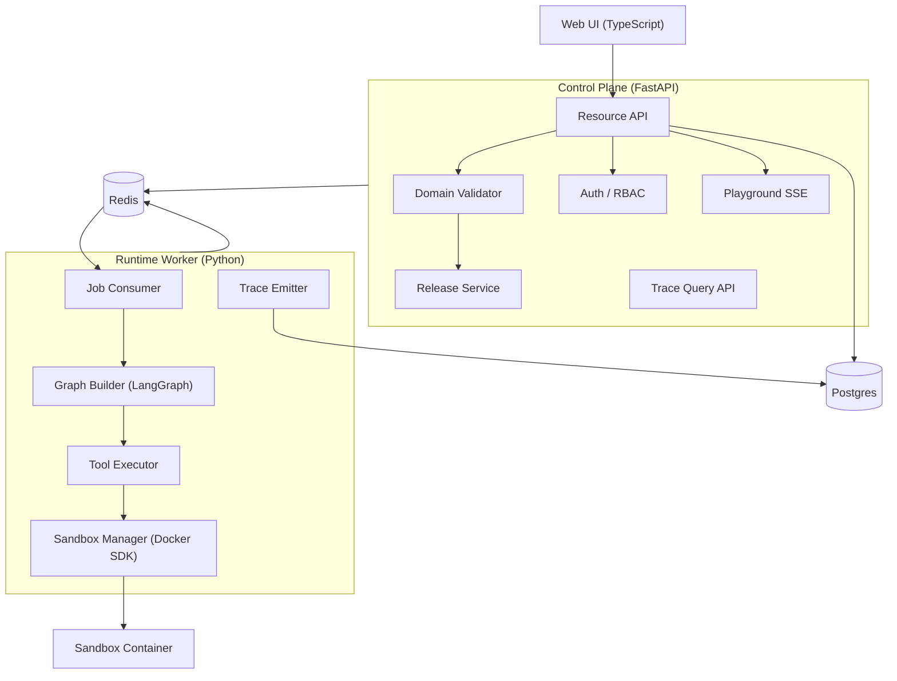

# Agent 平台设计文档

- 状态：草稿（待评审）
- 日期：2026-09-28
- 范围：v1 设计，不含实现
- 关联：[data-model.md](./data-model.md) —— 表结构与引用完整性约束

---

## 1. 概述

一个 Agent 平台：团队在上面**定义 Agent → 给 Agent 配置工具和 Skill → 运行调试 → 发布**。

平台采用**控制面 / 执行面分离**架构。控制面负责配置管理、版本发布、权限与查询；执行面（Runtime Worker）基于 LangGraph 以 **ReAct 循环**运行 Agent，工具调用走 HTTP API 或 Docker 隔离的 Python 脚本。

### 1.1 v1 范围

| 能力 | v1 |
|---|---|
| Agent 定义与配置管理（UI + API） | ✅ |
| 工具：外部 HTTP API / Python 脚本（Docker 隔离） | ✅ |
| Skill：指令知识包，渐进披露加载 | ✅ |
| 执行：ReAct 循环 + Agent 委派 | ✅ |
| 观测与调试（trace、Playground、成本） | ✅ |
| 版本管理与发布（草稿 / 发布 / 回滚 / diff） | ✅ |
| 多租户与权限 | ✅ |

### 1.2 非目标（v1 明确不做）

可视化拖拽画布；**工作流图编排**；**凭据管理领域**；MCP 协议支持；分布式沙箱（多节点执行）；评测与数据集；插件市场；灰度发布；配置的 Git 管理。

> 前两项不是永久排除，加回时的设计见 3.4 与 5.3。

---

## 2. 总体架构



### 2.1 关键约束

- **Control Plane 不调用 LLM。** 所有模型调用只发生在 Worker。
- **Postgres 是配置的唯一真相源。** 配置通过 UI/API 管理，不使用 Git 管理。
- **Worker 无状态。** 会话状态外置到 Postgres（LangGraph checkpointer 的 Postgres 后端），Worker 崩溃后任务可重投。
- **权限校验在两处发生**：API 层（编辑/查询）+ Worker 出队执行前（运行），后者不可省略。

---

## 3. 领域模型

物理表结构与引用完整性见 [data-model.md](./data-model.md)。本节描述领域划分与边界。

### 3.1 划分依据

模型按**领域**组织，不按技术分层。划分依据是**变更原因与所有权**：同一个领域里的表，因为同样的理由被改动、被同一批人关心。

依赖方向**必须无环**：

```
iam ──→ definition ──→ release ──→ execution

audit  ← 被上述所有领域写入（不反向依赖任何领域）
```

依赖是**严格线性**的：`execution` 只依赖 `release`，**不依赖 `definition`**。

| 领域 | 聚合根 | 职责 | 变更驱动 |
|---|---|---|---|
| `iam` | Tenant | 租户、工作区、成员、授权 | 组织调整 |
| `audit` | AuditEntry | 变更审计，只追加 | 合规要求 |
| `definition` | Agent / Tool / Skill | 定义：Agent 蓝图、工具接入、Skill 知识包 | 定义本身的演进 |
| `release` | Artifact | 草稿 → 版本 → 发布 → 回滚 | 发布策略 |
| `execution` | Run | 会话、运行、步骤、trace | 引擎演进与性能 |

**命名原则：前缀描述事物，不描述活动。** 用 `definition` / `release` 这样的名词，不用动名词 —— 前者一眼知道表里装什么，后者只说明这里在干什么。

**领域边界的依据：**

- **`release` 独立于各资源类型。** 版本与发布有自己的语言（草稿/发布/回滚/changelog）和不变式（版本单调、发布不可变），而且它**泛化于所有可发布物** —— 今天有 Agent/Tool/Skill，明天可能有 Prompt/Dataset/Eval。由它持有版本表，各领域不各自造一套。
- **`audit` 独立于 `iam`。** 两者的变更驱动不同（合规 vs 组织调整），且审计被**所有**领域写入。塞进一个笼统的"治理"领域，只会让边界说不清。
- **Tool / Skill / Agent 同属 `definition`。** 三者是同一类事物：**声明式的、可版本化的、定义一次可复用多次的蓝图**。它们放同一个领域、各建各的表 —— 变更驱动一致（都是"改定义"），而且 Agent 绑定 Tool/Skill 这条引用因此留在领域内，不必跨域。
- **运行实例不在定义域，也不直接引用定义。** 一份定义可以开出多个会话、多次运行 —— 但那属于 `execution`，而且执行域**只引用发布版本，不引用定义本身**：`execution_sessions` 与 `execution_runs` 都绑定 `(artifact_id, artifact_version)`。**运行只认已发布的版本。** 这比单纯的"定义 / 实例"分家更严 —— 它让依赖图严格线性，也让每一次运行都能精确复现。
- **每个领域的实体自己持有身份与并发控制。** `tenant_id` / `name` / `description` / `lock_version` 都在各自表上，没有共享父表；定义域里只有 Agent 有 `owner_id` 表示负责人。跨领域的统一列表走读模型（见 3.3）。

### 3.2 设计原则

1. **领域边界用表名前缀表达，不用数据库 schema。** 领域边界是应用层概念，不是数据库对象边界。单 schema 让迁移、备份、跨领域查询都保持简单。
2. **活数据强类型，历史快照序列化。** 当前态用真列、真索引、`CHECK` 约束；发布快照（`release_versions.spec`）用 JSONB —— 快照不可变、不按字段查询，JSONB 反而让版本 diff 退化为 JSON 比较。
3. **不使用数据库外键，引用完整性由应用层在事务内保证。** 代价是完整性从数据库强制降为程序强制，且失去级联删除与类型安全引用。[data-model.md](./data-model.md) 第 7 节规定了必须补齐的全部防线（引用清单 / 写入前校验 / 删除规则 / 孤儿巡检 / 导入路径）——**那是强制要求，不是建议**。
4. **权限全部由程序实现。** 数据库只有一个应用账号，对所有表有完整权限。授权数据存于 `iam_members` 与 `iam_grants`，判定发生在应用层。
5. **除执行域与审计域外一律软删除。** 实体删除 = `status = 'archived'`，行保留。这同时消除了大部分悬空引用风险。
6. **跨领域引用只能多态表达。** 用 `(kind, resource_id)` 而非具体外键列 —— 领域之间本来就不该有强耦合的引用。`kind` 的取值是**实体种类**（`agent` / `tool` / `skill`），不是领域名：合并之后一个领域里装着多种实体，只有种类才能定位到表。

### 3.3 表清单与读模型

按领域分组的 17 张表：

| 领域 | 表 |
|---|---|
| `iam_` | `tenants`, `workspaces`, `members`, `grants` |
| `audit_` | `logs` |
| `definition_` | `agents`, `tools`, `skills`, `skill_assets`, `tool_bindings`, `skill_bindings`, `delegations` |
| `release_` | `artifacts`, `versions` |
| `execution_` | `sessions`, `runs`, `steps` |

没有共享父表，因此"列出某租户下所有可发布物"这类跨领域查询没有一张表可查。**这类查询走读模型（CQRS 的投影），不污染领域模型。**

- 投影由领域写操作驱动更新，可随时从领域表重建 —— 重建脚本是它存在的必要配套。
- 典型投影 `read_model_catalog`：汇总 `(tenant_id, domain, kind, name, description, status, latest_version, updated_at)`，供列表页与搜索使用。
- 读模型**不参与业务写入**。代价是投影有延迟，且每次领域写入后需触发更新。

### 3.4 未来领域的接入点

两个 v1 不做的领域，将来加回时的位置：

- **凭据管理（`secrets_`）**：独立领域，被 `definition` 依赖。`definition_tools` 增加 `credential_id` 列指向它。**它的加回优先级应该高于其他功能** —— 见 5.3 说明的当前风险。
- **工作流编排（`workflow_`）**：独立领域，依赖 `definition`。它引入显式图（节点/边/可达性），与 ReAct 是两种并存的执行模型，届时 `execution_steps.step_kind` 需要补回 `condition`，多态引用的 `kind` 值域也要相应扩展。

### 3.5 快照序列化契约

领域实体（聚合根 + 其组成部分）与 `release_versions.spec` 之间需要一个**双向映射**。这是本设计中最关键的复用点，必须只有一份实现：

- 用 pydantic 模型定义 `AgentSpec` / `ToolSpec` / `SkillSpec`。
- 提供 `to_spec(domain, entity_id) -> Spec` 与 `from_spec(Spec) -> rows` 两个方向。
- `from_spec` 同时服务于：创建、更新、导入、版本回滚。

**回滚即复制**：读旧版本的 `spec` → `from_spec` 写回领域表 → 走一次正常发布流程。回滚本身也产生新版本、也进审计。

聚合内组成部分的更新策略：**全量替换**（事务内 `DELETE` + `INSERT`）。v1 不做集合 diff，简单且正确。

### 3.6 spec 结构版本

每个 `spec` 内嵌 `apiVersion`（如 `agentops/v1`）。配置模型演进时，迁移任务按键升级旧配置，避免老配置静默失效。历史快照因为内嵌了版本号，永远可解析。

---

## 4. 配置编辑与发布

### 4.1 编辑流程

编辑发生在**领域表**上（草稿态），不在 release 领域：

```
UI 表单 → GET /api/v1/{domain}/{id}            （返回资源 + lock_version）
        → PUT /api/v1/{domain}/{id}
             If-Match: <lock_version>
             ├─ pydantic schema 校验
             ├─ 引用完整性校验（存在 / 领域类型 / 同租户 / 可见性）
             ├─ 聚合内不变式（委派环检测）
             ├─ lock_version 不匹配 → 409 Conflict
             └─ 单事务：写领域表 + 其组成部分
                        lock_version += 1
                        写 audit_logs
```

并发冲突时前端提示"配置已被他人修改"，展示字段级差异供人工合并。

引用校验的完整规则见 [data-model.md](./data-model.md) 7.2。

### 4.2 发布流程

发布是**快照**，由 release 领域执行：

```
POST /api/v1/{domain}/{id}/publish  { changelog }
  BEGIN
    -- 1. 领域实体序列化为 spec
    spec = to_spec(domain, entity_id)

    -- 2. 首次发布时创建 artifact，否则复用
    artifact = UPSERT release_artifacts (domain, entity_id)

    -- 3. 版本单调递增
    version = max(version) + 1  FROM release_versions WHERE artifact_id = artifact.id

    INSERT INTO release_versions(artifact_id, version, spec, changelog, published_by)
    UPDATE release_artifacts SET current_version_id = <new>, status = 'published'
    写 audit_logs
  COMMIT
```

- **会话与 Run 都绑定 `(artifact_id, artifact_version)`**，历史执行可精确复现。执行域因此完全不依赖定义域。
- 归档 = `release_artifacts.status = 'archived'`，不物理删除。
- 草稿的并发控制（`lock_version`）留在领域实体上 —— 那是**编辑**的并发；发布状态在 `release_artifacts` 上 —— 那是**发布**的并发。两者不混。

### 4.3 版本 diff

两个 `release_versions.spec` 做结构化 JSON diff。因为结构由 schema 确定，diff 可渲染为字段级对比而非文本对比。前端展示差异时按字段路径分组。

### 4.4 导入 / 导出

作为**通道**存在，不是真相源。用途：备份、跨环境迁移（dev→staging→prod）、CI 校验。

```
GET  /api/v1/{domain}/{id}/export?format=yaml|json
POST /api/v1/import   { onMissingRef: fail | create-stub }
```

**ID ↔ 业务标识的翻译发生在边界。** 数据库内部用 UUID 关联，但跨环境时 UUID 必然不同，因此导出时必须把引用渲染为 `{domain, kind, name}` 业务标识，导入时在目标环境解析回 UUID。这个翻译层是导入导出的核心实现。

**导出的文件里绝不能出现明文密钥** —— HTTP 工具的认证信息是 `${ENV_VAR}` 占位符（见 5.3），导出时原样保留占位符，不做解析。

导入会批量写入跨领域引用，必须单事务 + 按领域依赖拓扑排序 + 逐项校验，详见 [data-model.md](./data-model.md) 7.5。默认 `onMissingRef: fail` 并返回缺失引用清单。

---

## 5. 工具执行

### 5.1 HTTP 工具

Worker 直接以 httpx 调用。能力：参数模板替换、环境变量占位符解析、超时与有限重试、**响应裁剪**（超过 `max_output_bytes` 截断并标注，防止大响应撑爆上下文）。

### 5.2 Python 工具

Sandbox Manager 通过 Docker SDK 启动**一次性容器**。

| 项 | 策略 |
|---|---|
| 镜像 | 基础镜像 + 工具声明的依赖，**预构建**（`py_image_tag` 记录产物） |
| 网络 | 默认**完全禁用**；需联网必须显式声明 `py_network_policy` 并走白名单代理 |
| 文件系统 | 只读根 + 可写 `/output` |
| 限额 | CPU / 内存 / 磁盘 / 墙钟超时（`timeout_seconds`），超时强杀 |
| 契约 | stdin 收 JSON，stdout 吐 JSON，`/output` 目录回传产物 |
| 生命周期 | 一次性，用完销毁（不复用容器） |

> **运行时不做 `pip install`。** 加工具需要走一次镜像构建流程。这是刻意选择：运行时装依赖既是安全漏洞也是性能灾难。

### 5.3 凭据处理（v1 的临时方案）

v1 **没有凭据管理领域**。HTTP 工具的认证信息这样处理：

- 配置里写**占位符**：`"Authorization": "Bearer ${GITHUB_TOKEN}"`。
- 执行时由 Worker 从**自己的环境变量**解析占位符，替换后发出请求。
- 落库的只是占位符字符串，明文密钥永不落库、永不进导出文件。

**代价必须记在账上：**

| 缺失的能力 | 后果 |
|---|---|
| 集中管理 | 密钥分散在各 Worker 的部署环境，改一个要动所有节点 |
| 轮换机制 | 没有到期提醒，没有平滑轮换 |
| 使用审计 | 无法回答"哪个 Agent 用了这个密钥" |
| 租户隔离 | 环境变量是进程级的，多租户共用一个 Worker 时无法隔离 |

**在单个 Worker 承载多租户之前，凭据领域必须加回来。** 这是 3.4 里标注它优先级最高的原因。

---

## 6. Skill 加载

类渐进披露机制：

1. Agent 启动时，把绑定的**全部** Skill 的 `name` + `description` 注入系统提示 —— 开销很小。
2. `load_policy = 'always'` 的 Skill 全文直接注入。
3. `load_policy = 'on_demand'` 的由模型通过内置工具 `read_skill(name)` 拉取全文。
4. 拉取后的内容进入会话上下文并可缓存，同一会话内不重复拉取。

因此绑定 50 个 Skill 也不会撑爆上下文。`definition_skill_bindings.ord` 决定注入顺序 —— 该顺序影响 prompt cache 命中率，应保持稳定。

> `definition_skills.description` 是**必填**字段：渐进披露完全依赖它来判断该不该拉取正文，缺了它这个机制就失效。

---

## 7. 执行模型（ReAct）

### 7.1 ReAct 循环

v1 的执行模型是标准 ReAct：**LLM 决策 ↔ 工具执行**循环，直到模型不再请求工具或触达上限。

```
        ┌─────────────────┐
        │   LLM 节点       │
        └────────┬────────┘
                 │
        有工具调用？ ──否──→ 结束（返回最终回答）
                 │是
                 ▼
        ┌─────────────────┐
        │   ToolNode      │  ← 执行工具，结果回填上下文
        └────────┬────────┘
                 └──→ 回到 LLM 节点
```

**没有显式图编排** —— 控制流由模型自己决定，而不是由人预先画好。

**ReAct 的核心价值是灵活性：** 它能处理人没有预先枚举的路径、任务变化时只需改 prompt 而非重画流程。这正是引入 LLM 的意义 —— 如果流程完全确定，用普通工作流引擎就够了，不需要模型。

**代价是可控性**，且这些代价必须被正视：

| 失去的 | 后果 |
|---|---|
| 可预测性 | 同样输入可能走出不同路径 |
| 可解释性 | 出错时难以回答"为什么走了这条路" |
| 成本可预估性 | 可能绕远路，token 消耗事先算不出来 |
| 硬约束 | "必须先 A 再 B"这类要求只能靠 prompt 约束，模型可能不遵守 |

**判断原则：一旦某段流程被证明是稳定的，就该把它固化成代码或工具，而不是让模型每次重新决策。** 灵活性留给真正不确定的那部分。需要显式图编排时，见 3.4 的接入点。

循环上限由 `definition_agents.max_steps` 强制。**这个值必须有**：没有它，一个陷入循环的 Agent 会一直烧 token。

### 7.2 委派（Agent-as-Tool）

`definition_delegations` 把子 Agent 包装成父 Agent 的一个工具 —— 所以委派**是 ReAct 循环里的一种工具调用**，不是独立的编排机制。

父 Agent 调用 → 起一个独立子 Run → 结果回传。子 Run 有自己的 `execution_steps` 树，通过 `parent_step_id` 挂到父 Run 的对应步骤下。

`expose_as` 是父 Agent 的 LLM 看到的名字，必须在父 Agent 内唯一；`description_override` 允许父 Agent 用不同措辞描述子 Agent。

> 委派可能成环（A 调 B、B 调 A）。没有外键，数据库不提供任何保护 —— **环检测是应用层的强制校验**，在保存与编译时各做一次。

### 7.3 运行图的构建

Graph Builder 的职责被 ReAct 简化了：**只为每个 Agent 生成一张固定的 ReAct 图**（LLM 节点 + ToolNode + 条件边），不需要编译用户定义的图结构。

- 工具集 = `definition_tool_bindings` 解析出的工具 + 委派包装出的子 Agent 工具 + 内置的 `read_skill`。
- 会话状态由 LangGraph checkpointer 持久化到 Postgres（`execution_sessions.state`）。
- 未来加回工作流编排时，Graph Builder 才需要重新支持从 `workflow_*` 表编译图（见 3.4）。

---

## 8. 观测与调试

- **统一 trace**：`execution_runs` → `execution_steps` 树，每步记录输入/输出/token/耗时/成本。直接消费 LangGraph 的 callback 事件。
- **在线试跑 Playground**：UI 实时流式观察每一步，支持中断、单步、改参数重跑（经 Control Plane 的 SSE 代理）。
- **回放**：依据 `execution_steps` 重建完整会话。
- **成本**：按模型单价表换算进 `execution_runs.cost_usd`。
- 存储使用 Postgres JSONB 字段，**不引入独立的 trace 系统**。后续可通过导出适配器对接外部平台。

---

## 9. 权限与多租户

**权限完全由程序实现**：数据库只有一个应用账号，对所有表有完整权限，判定发生在应用层。

- **Agent 有负责人**：`definition_agents.owner_id` 对该 Agent 有全权（编辑 / 发布 / 运行 / 转移归属）。`owner_id` 是负责人（可转移，人走了要交接），与 `created_by`（谁最早建的）不是一回事。
- **定义域里只有 Agent 有负责人。** Tool 与 Skill 是共享能力，没有归属人 —— 它们由租户角色和资源授权管辖，不存在"谁的 Tool"这种说法。
- **判定顺序，第一个命中即停**：① Agent 的 `owner_id` → 全权；② 同租户成员 → 按角色（`owner` / `editor` 可编辑，`runner` 可运行，`viewer` 只读）；③ 资源授权（`iam_grants`）→ 按授权角色；④ 其他 → 拒绝。
- 层级：`Tenant → Workspace → Resource`。
- 细粒度：`iam_grants`（针对单个资源授权给用户或组，用 `(resource_kind, resource_id)` 多态定位，`kind` 取 `agent` / `tool` / `skill`）—— 多人协作、需要单独授权时才启用。
- 有效权限 = owner 权限 ∪ 成员角色 ∪ 资源授权；冲突时取更宽者。

> **v1 只有资源级权限，没有工具级权限。** Agent 能做什么，运行它的人就间接能做什么 —— 因为 Agent 拿自己的权限替用户做事，而用户不一定有同样的权限（confused deputy）。自用场景下可接受：维护者本来就是全权限。**升级触发条件是「第一个人开始运行你维护的 Agent」**，届时需要工具级 scope 与调用校验。
- **运行时强制**：Worker 出队执行前校验调用者对该资源的 `run` 权限。权限检查不能只在 API 层。
- **授权挂在定义上，执行引用的是版本。** `owner_id` 在 `definition_agents` 上，`iam_grants.resource_kind` 也指向定义 —— 而会话与 Run 绑定的是 `release_artifacts`。Worker 判权时要沿 `artifact → entity` 反查回定义，这一步不能省。
- 跨租户访问一律拒绝，不做例外。

---

## 10. 部署形态

v1 单机 `docker-compose`：

| 服务 | 说明 |
|---|---|
| `control-plane` | FastAPI，无状态，可多副本 |
| `runtime-worker` | LangGraph 运行时，可多副本，需挂载 docker socket |
| `postgres` | 唯一数据存储 |
| `redis` | 任务队列 + 流式事件 pub/sub |
| `web` | 前端静态资源 |
| `nginx` | 反向代理（可选） |

沙箱不单独部署服务，由 Worker 内嵌的 Sandbox Manager 通过 docker socket 直接管理。

---

## 11. 目录结构

```
agent-ops/
├── docs/              # 设计文档
├── shared/            # 共享 pydantic schema 与 spec 模型（领域模型的唯一定义）
├── control-plane/     # FastAPI 控制面
├── runtime/           # LangGraph 运行时 worker
├── sandbox/           # 沙箱基础镜像与执行器
├── web/               # 前端
└── deploy/            # docker-compose 与部署脚本
```

`shared/` 是 DRY 的关键：Control Plane 的校验、Worker 的编译、导入导出、快照序列化全部依赖同一份 spec 模型定义。

---

## 12. 路线图

| 里程碑 | 内容 |
|---|---|
| M1 | 领域模型 + spec 定义 + 校验器（schema / 引用 / 不变式） |
| M2 | `iam` + `audit` 领域 |
| M3 | `definition` 领域：工具与 Skill + Control Plane Resource API |
| M4 | `definition` 领域：Agent 定义、绑定与委派 |
| M5 | `release` 领域（发布 / diff / 回滚） |
| M6 | Worker：ReAct 执行 + HTTP 工具 |
| M7 | Python 工具沙箱（Docker） |
| M8 | Skill 渐进加载 |
| M9 | `execution` 领域：Trace + Playground |
| M10 | Agent 委派 |
| M11 | 读模型与跨领域查询 |

本设计覆盖 M1–M11，规模超出单个实现计划。**每个里程碑应产出各自独立的实现计划**，按顺序推进；M1（领域模型 + spec 定义）是其余一切的前置依赖。

---

## 13. 关键权衡与风险

| # | 取舍 | 收益 | 代价 |
|---|---|---|---|
| 1 | 按领域建模 | 边界清晰；独立的版本与审计领域；依赖方向可验证 | 跨领域查询变啰嗦，需要读模型 |
| 2 | 不使用共享父表 | 领域模型不被技术诉求污染 | 失去"统一资源列表"，必须建读模型并维护投影 |
| 3 | 全列式 + 关联表（而非 JSONB） | 真索引、`CHECK` 约束、类型清晰 | **每次 spec 演进都要 migration**；读写需 JOIN |
| 4 | **不使用数据库外键** | 写入路径无外键锁开销；便于将来拆库 | 完整性降级为程序强制；失去级联删除与类型安全引用；需自制校验 + 软删除 + 孤儿巡检 |
| 5 | **权限全部程序实现** | 授权模型可以任意复杂；不受数据库角色体系限制 | 无数据库层兜底，任何绕过服务层的写入都不受限 |
| 6 | 领域边界用前缀而非数据库 schema | 迁移、备份简单；跨领域查询无 schema 前缀负担 | 边界在数据库层不可见，无法用 schema 级权限做隔离 |
| 7 | **v1 不做凭据管理**（用环境变量占位符） | 少一个领域，快速落地 | **密钥分散、无法轮换、无使用审计、无租户隔离** —— 单 Worker 承载多租户前必须加回 |
| 8 | **v1 只用 ReAct**（不做图编排） | **灵活：能处理未预先枚举的路径，任务变化只需改 prompt**；Graph Builder 大幅简化 | **用灵活性换可控性**：不可预测、难解释、成本难预估、无法强制顺序约束。稳定流程应尽快固化成工具 |
| 9 | 配置由 UI/DB 管理（而非 Git） | 编辑路径直接、无 merge 冲突 | 失去 PR review 与 Git 历史；审计日志成为唯一追溯手段 |
| 10 | Python 工具预构建镜像 | 安全、快 | 加工具要走一次镜像构建 |
| 11 | 容器不复用 | 无状态污染、无并发问题 | 每次调用有冷启动开销 |
| 12 | 历史快照用 JSONB | diff 简单、免迁移 | 快照内容无数据库层校验，依赖序列化契约 |
| 13 | **把 Tool / Skill / Agent 合并为一个 `definition` 域** | 三者同属一类事物（定义）；少一条领域依赖；两条跨领域引用降为领域内，完整性防线更简单 | **失去"变更驱动"这条边界** —— 工具接入、Agent 调优、Skill 编写三种变更同处一域。多人分工时这是第一个该重审的边界 |

### 待定项

1. **权限模型何时升级到工具级。** v1 只有资源级权限（owner + 角色），没有工具级权限。**触发条件：第一个人开始运行你维护的 Agent。** 届时需要三件事：工具声明所需 scope、只有具备该 scope 的用户才能把它绑定到 Agent、调用时校验发起者是否有该 scope。高风险工具还需人工审批环节。
2. **凭据管理何时加回。** 见 5.3 的风险表 —— 它列的四项缺失全是真实的安全债。建议不晚于"单 Worker 承载多租户"那一刻。
3. **发布是否需要审批流。** 失去 Git PR review 后，如果仍需要"变更需批准"，建议在 release 领域加可选的审批步骤（发布前需 owner 批准）。
4. **`definition_tools.py_source` 的存储位置。** 当前设计存在表中（TEXT）。若脚本体积增大，应迁至对象存储，仅在表中存引用（与 `definition_skill_assets` 一致）。
5. **`definition` 大域是否该再分子域。** v1 把 Tool / Skill / Agent 合为一个定义域，理由是三者同属一类事物。但三者的**所有者可能不同**（集成工程师写 tool，领域专家写 skill，产品改 agent），按所有权标准可以再拆 —— 真到多人分工时，这是第一个该重审的边界。
6. **模型目录是否该独立成领域。** 目前 `model_provider` / `model_name` 是 `definition_agents` 上的两个列。若将来需要模型单价表、配额、路由策略，应抽出 `model_` 领域。
7. **读模型的更新方式。** 同步触发（与写同事务）还是异步事件驱动？前者简单但写入变慢，后者快但有延迟。
8. **ReAct 的可解释性如何缓解。** 灵活性带来的不可解释性只能缓解、不能消除。可选做法：在 trace 里额外记录每轮的工具选择理由（模型输出的 reasoning）。这能回答"它做了什么"，但回答不了"它为什么没做另一件事"。是否进 v1 待定。
9. **哪些流程该固化。** 按 7.1 的判断原则，稳定流程应固化成工具而非让模型每次决策。但"稳定"由谁判定、固化到什么粒度（一个工具？一段代码？），目前没有标准。
10. **未发布的草稿怎么试跑。** 执行域只认已发布版本，那调试中的草稿怎么运行？三种做法各有代价：① 调试也走正常发布 —— 版本历史会被试跑污染；② 引入"调试版本"标记，正常记录但不推进 `current_version_id` —— 多一个概念，但版本语义干净；③ Playground 走一条不经 release 的旁路 —— 会打破"运行只认版本"这条约束，不推荐。v1 选哪种待定，**但必须先定**：Playground 是 v1 范围内的功能。
